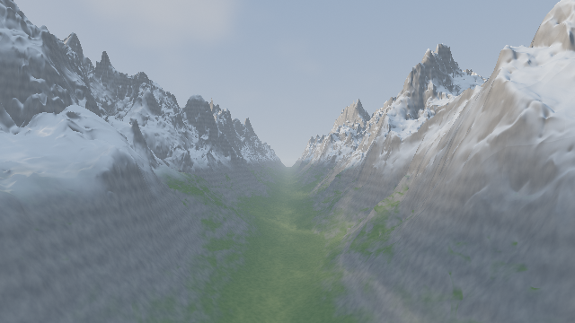
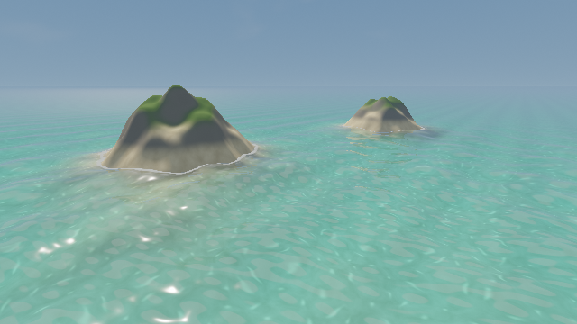

# Metal Shader Skills

Procedural shader art for **Metal 4**, written in **Metal Shading Language 4.1**.
A fork of [gokayfem/shader-skills](https://github.com/gokayfem/shader-skills), with
native MSL code, an Apple compiler check, and a renderer that uses the Metal 4 API.

The installable `metal-shader-art` skill helps coding agents create SDF scenes,
noise, terrain, water, clouds, lighting, and color. It includes 20 library modules,
11 scene templates, subject guides, a dependency bundler, and native previews.
The upstream MIT license and technique credits are preserved.

| | | |
|---|---|---|
| [](gallery/raymarch-sdf.metal) | [](gallery/alpine-valley.metal) | [](gallery/volumetric-clouds.metal) |
| SDF modeling and PBR light | Eroded terrain and atmosphere | Volumetric integration |
| [](gallery/sdf-2d-poster.metal) | [](gallery/pattern-swatches.metal) | [](gallery/coastal-water.metal) |
| 2D distance fields | Procedural materials | Refraction, absorption, foam |

The gallery images are native Metal renders. Each image links to a complete
`.metal` bundle. Editable scene inputs are in
[`skills/metal-shader-art/templates/`](skills/metal-shader-art/templates/).

## Install

With the skills CLI:

```sh
npx skills add calrizien/metal-shader-skills
```

For Codex, copy the skill directory into your skill location:

```sh
mkdir -p ~/.agents/skills
cp -R skills/metal-shader-art ~/.agents/skills/
```

For Claude Code:

```sh
claude plugin marketplace add calrizien/metal-shader-skills
claude plugin install metal-shader-skills@metal-shader-skills
```

For manual Claude installation, copy the directory to `~/.claude/skills/`.
Cursor, Copilot, and chat adapters are in [`adapters/`](adapters/).

## Use

Ask: *“Use metal-shader-art to make a Metal 4 shader of a glass sculpture under
soft studio light.”* Or: *“Port this GLSL landscape to MSL 4.1 and show a native
render.”*

From the installed skill directory:

```sh
python3 scripts/metal_tools.py search terrain noise
python3 scripts/metal_tools.py bundle templates/raymarch-sdf.metal -o final.metal
python3 scripts/metal_tools.py check final.metal
python3 scripts/metal_tools.py render final.metal --output build/preview --size 640x360 --time 1.2
```

`search` finds functions by name and use. `bundle` includes the required helpers
and emits native `fullscreenVertex` and `shaderFragment` entry functions.
`check` uses Apple's compiler with `-std=metal4.1`; a missing compiler is a
failure. `render` saves a PNG, generated MSL, full diagnostics, and a JSON receipt.
Use `check --lint-only` only when a static check is the intended result.

Compilation needs Xcode 27 or later and the Metal Toolchain. Native rendering
needs an Apple silicon Mac with macOS 27 or later and a Metal 4 GPU. The scripts
use Python's standard library. They do not need a browser or an API key.

## What changed from upstream

| Area | Metal fork |
|---|---|
| Language | Native `floatN`/`floatNxN`, MSL references, arrays, texture sampling |
| Scene entry | `shade(thread float4 &, float2)` inside a thread-local scene object |
| Output | Complete native Metal vertex and fragment functions |
| Uniforms | Explicit 16-byte buffer: resolution, time, frame |
| Compiler | `xcrun metal -std=metal4.1`, safe math |
| Renderer | MTL4 compiler, queue, command buffer, allocator, argument table, residency set |
| Validation | Original numerical GPU properties, native floating-point image checks, PNGs and hashes |
| Packaging | Metal skill name, plugin manifests, adapters, guides, and macOS CI |

Read the [Metal 4 integration guide](skills/metal-shader-art/references/metal4-integration.md)
for resource lifetime, synchronization, buffer layout, texture binding, and color.
MSL 4.1 is the explicit baseline, matching Apple's current specification.
The host API and language version are separate requirements.

## Library

The [function index](skills/metal-shader-art/references/library-index.md) contains
signatures, use cases, and SDF exactness tags. The modules cover:

- Integer hashes, value/gradient/simplex noise, fBm, warping, Voronoi and curl noise.
- 2D and 3D distance fields, blends, repetition, deformation and raymarching.
- Procedural buildings, terrain, water waves, Fresnel and absorption.
- PBR light, atmosphere, volume integration, cameras and intersections.
- Linear/sRGB color, Oklab, tone mapping, antialiasing and debug views.

The scene adapter uses bottom-left pixel coordinates and converts Metal's
viewport origin once. Templates encode sRGB manually and need a non-sRGB output
target. For an `_sRGB` attachment, remove the manual encoding.

## Verification

Run from the repository root:

```sh
python3 skills/metal-shader-art/scripts/metal_tools.py index --check
python3 tests/build_gallery.py --check
python3 skills/metal-shader-art/scripts/metal_tools.py check
python3 tests/check_evals.py
python3 tests/run_metal.py --size 640x360 --save-gallery
```

The native suite compiles library modules, reference definitions, templates, and
annotated variants. It runs **90 GPU property cases with 16,384 samples each**
and **27 renders**. The properties retain upstream tolerances. The renderer uses
Metal API validation, checks float pixels for NaN/infinity and empty output,
then saves PNGs. The [receipt](verification/metal-results.json) and
[source hashes](verification/inputs.json) identify the tested state. Full
sources and diagnostics remain in the local `build/` output.

[CI](.github/workflows/checks.yml) compiles MSL on a macOS arm64 runner. Native GPU
CI is an optional [manual workflow](.github/workflows/metal-gpu.yml) for a trusted
self-hosted Mac. A hosted compiler check does not prove GPU execution.
[Model evaluation cases](evals/README.md) are prepared and format-checked;
paid model evaluations have not been run for this fork.

This is a procedural fragment-art library. It does not establish iOS/visionOS
runtime, SwiftUI stitchable shader, RealityKit material, ML/tensor, mesh, or
ray-tracing integration. Those targets need their own host contracts and checks.

## License and source

[MIT](LICENSE). Based on upstream commit
[`e09bc993`](https://github.com/gokayfem/shader-skills/commit/e09bc993bf04201f26c03c87c89210e9b472f526).
See [CREDITS.md](CREDITS.md) for authors and technique sources. Apple documentation
is linked; the specification PDF is not redistributed.
