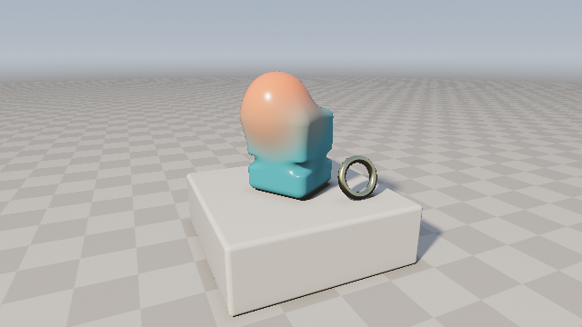
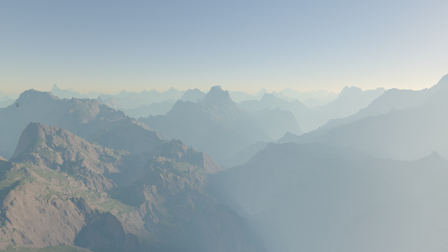
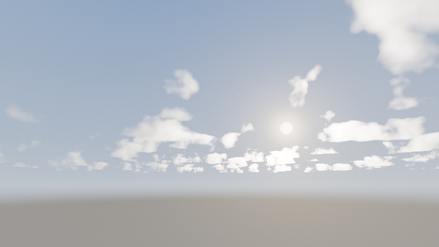
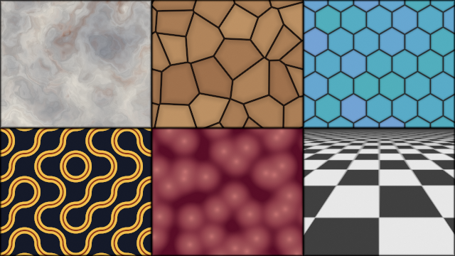
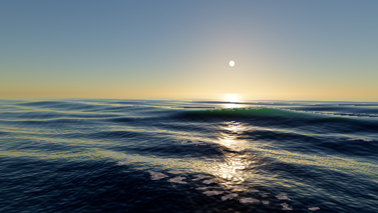

# Shader Skills

A skill that teaches coding agents to write procedural GLSL shaders that compile on the first try and look
intentional. It works with Claude Code, Codex, Cursor, Copilot, Gemini and others. It pairs a shader-craft
workflow with a **verified GLSL building-block library**: 179 functions across 18 modules, each one compiled in
WebGL2 and numerically tested on the GPU. A bundler inlines exactly the functions a shader uses, so the result
pastes straight into Shadertoy.

| | | |
|---|---|---|
| [](gallery/raymarch-sdf.glsl) | [](gallery/terrain.glsl) | [](gallery/volumetric-clouds.glsl) |
| SDF still life: smooth blends with blended materials, PBR, soft shadows, AO, AgX | Eroded terrain under a physically based sky with aerial perspective | Volumetric cumulus: energy-conserving integration, Beer-Powder, dual-lobe phase |
| [](gallery/sdf-2d-poster.glsl) | [](gallery/pattern-swatches.glsl) | [](gallery/ocean.glsl) |
| 2D distance-field poster: Oklab gradients, polar leaves, Bézier trunks | Texture-free materials: warped marble, Voronoi cracks, hex tiles, Truchet, filtered checker | Ocean: dispersive waves with analytic curvature foam, Fresnel sky, glitter path widening with distance |

Each image links to its paste-ready shader. The sources are in [`skills/shader-art-coding/templates/`](skills/shader-art-coding/templates/).

## Why

Agents write shaders blind: they cannot see the output, they misremember formulas, and WebGL rejects code that
desktop GLSL accepts. Common results are struct ternaries, sine hashes that differ per GPU, SDFs with wrong signs,
double gamma, and fog that ignores the sky. This skill closes those gaps:

- **Tested building blocks instead of recalled ones.** Every SDF is checked on the GPU:
  - the Lipschitz bound (safe to raymarch);
  - exactness, by projecting points onto the surface;
  - inside/outside signs;
  - for curves, agreement with brute-force distance.

  Noise derivatives are checked against finite differences, curl noise for zero divergence, color transforms for
  round trips, and intersectors against their SDFs.
- **A bundler,** so the agent writes `sdRoundCone(...)`, `softShadow(...)`, `tonemapAgX(...)` by name and ships one
  self-contained file.
- **A checker** that catches WebGL1 leftovers, sine hashes, `#version` lines and missing `mainImage`, and compiles
  with glslangValidator.
- **A workflow** with a fixed debug-mode convention, so problems are inspected as fields rather than guessed at.
- **Routing** from subjects ("a jellyfish", "snowy mountains") to techniques, templates and formulas.

## Install

**Claude Code** (plugin marketplace):

```bash
claude plugin marketplace add gokayfem/shader-skills
```

```bash
claude plugin install shader-skills@shader-skills
```

Or copy the skill: `cp -R skills/shader-art-coding ~/.claude/skills/`.

**Codex, Cursor, Gemini CLI, Copilot and about 70 other agents** (via [skills](https://github.com/vercel-labs/skills)):

```bash
npx skills add gokayfem/shader-skills
```

Or install by hand:
- **Codex:** copy `skills/shader-art-coding` to `~/.agents/skills/`.
- **Cursor:** copy it to `~/.cursor/skills/`, plus the rule in `adapters/cursor/`.
- **Copilot:** `gh skill install gokayfem/shader-skills shader-art-coding`, plus `adapters/copilot/`.
- **Gemini CLI:** `gemini extensions install https://github.com/gokayfem/shader-skills`.
- **Hermes:** copy it to `~/.hermes/skills/`.

**claude.ai:** zip `skills/shader-art-coding` and upload it under Settings > Capabilities > Skills.

**ChatGPT, Gemini Gems and other chat tools:** see [`adapters/`](adapters/).

## Use

Ask naturally: *"Make a Shadertoy shader of a glass jellyfish drifting through god rays"*, or *"why does my
raymarcher have holes?"* The skill routes the request, then the agent finds blocks, writes the shader, bundles it
and checks it:

```bash
python3 scripts/glsl_tools.py search petal leaf
python3 scripts/glsl_tools.py bundle jellyfish.glsl -o jellyfish.out.glsl
python3 scripts/glsl_tools.py check jellyfish.out.glsl
```

What the commands do:
- `search` ranks functions by name, summary and `@use` tags.
- `bundle` resolves dependencies transitively and emits them in declaration order.
- `check` lints the file and compiles it when `glslangValidator` is installed (`brew install glslang` or
  `apt install glslang-tools`).

## What's in the library

| Module | Highlights |
|---|---|
| `hash` | PCG integer hashes (`pcg3d`, `pcg4d`): bit-exact across GPUs, no sine; safe integer-input float wrappers |
| `noise` | value and gradient noise with analytic derivatives, fBm, eroded fBm, ridged fBm, two-level domain warp, curl noise, Voronoi (F1/F2, exact borders, smooth), interleaved-gradient and R2 dithering |
| `pattern` | box-filtered checker, grid and stripes (alias-free with no supersampling), hex grid with edge distance, Truchet |
| `sdf3d` | 22 primitives including exact capped cone, round cone, cut and hollow spheres, death star, hex prism, link, gyroid, 3D Bézier tube |
| `sdf2d` | 16 primitives including vesica, moon, heart, star, regular polygon, rounded box with per-corner radii, quadratic Bézier |
| `operators` | smooth min/max/subtract (quadratic and C2 cubic), smooth union with material blend weight, chamfer, stairs, engrave, round, onion, extrude, revolve, exact elongate |
| `domain` | repetition (infinite, limited, mirrored), polar sectors, folds, twist and bend with their Lipschitz corrections |
| `raymarch` | sphere tracing with distance-relative hit threshold, tetrahedral normals, improved soft shadows, AO, thickness; WebGL-safe loops |
| `shading` | GGX + height-correlated Smith + Schlick, metallic-roughness `shadePBR`, environment BRDF approximation, wrap diffuse, translucency, rim |
| `color` / `tonemap` | exact sRGB curves, Oklab / OkLCh mixing, blackbody colors; AgX (default), AgX punchy, Khronos PBR Neutral, ACES fitted, Reinhard |
| `volume` / `atmosphere` | HG, dual-lobe, Rayleigh and Cornette-Shanks phase, energy-conserving `volumeStep`, Beer-Powder, analytic height fog; physically based single-scattering sky, sun disk with limb darkening |
| `camera` / `intersect` / `post` / `debug` | look-at, thin-lens DOF, ortho; analytic sphere/box/plane hits; AA helpers, R2 supersampling offsets, cos⁴ vignette, grain, TPDF dither; distance, normal, id and heat debug views |

The full catalog with signatures, exactness and uses is
[`references/library-index.md`](skills/shader-art-coding/references/library-index.md).

## Verification

| Check | Where | What it proves |
|---|---|---|
| Lint + drift | `glsl_tools.py check` | docs and tags on every function, module order, no WebGL1 or sine-hash patterns, reference snippets identical to the library |
| glslang compile | CI (`checks.yml`) | every library module, reference snippet and template compiles as GLSL ES 3.00 |
| WebGL2 compile | `tests/` harness | all 147 units compile under ANGLE, which also enforces WebGL-only rules |
| GPU property tests | `tests/properties.py` | 84 tests × 16,384 samples: Lipschitz, exactness, signs, brute-force curve distance, derivatives, divergence, ranges, round trips |
| Renders | harness + gallery | every template renders with no NaNs and no black frames; images saved to `gallery/` |

Run it locally: `python3 tests/build_harness.py && python3 tests/serve.py`, then open
`http://127.0.0.1:8765/build/harness.html`. Headless: `python3 tests/run_webgl.py` (needs Playwright).

## Conventions

- `#define DEBUG_MODE 0`: 0 final, 1 distance field, 2 normals, 3 ids, 4 steps, 5 masks, 6 lighting terms.
- Scene contract `vec2 map(vec3 p)` returns `vec2(distance, materialId)`.
- Color pipeline:
  1. Light in linear color.
  2. Apply exposure.
  3. Tonemap each AA sample.
  4. Average the samples.
  5. Encode once with `linearToSrgb`.
  6. Dither.

## Repository

```text
skills/shader-art-coding/   the skill: SKILL.md, glsl/ library, templates/, references/, scripts/glsl_tools.py
tests/                      WebGL2 harness, GPU property tests, gallery builder, headless runner
gallery/                    rendered templates and paste-ready bundles
adapters/                   prompts for tools without skill support
.claude-plugin/             Claude Code plugin + marketplace manifests
```

Contributing: see [AGENTS.md](AGENTS.md) for the rules every library change must pass.

## Credits and license

MIT. Every function is an original implementation of a published technique. The sources are listed in
[CREDITS.md](CREDITS.md): Inigo Quilez's articles, hg_sdf, Jarzynski & Olano's GPU hash study, Hillaire's
atmosphere and volume work, AgX, Khronos PBR Neutral, Oklab and others.
